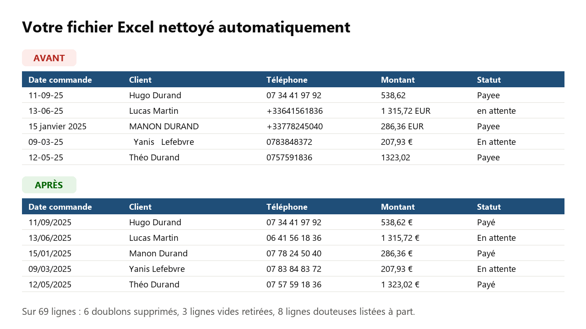

# Nettoyage Excel


Nettoie un fichier de commandes Excel ou CSV : formats unifiés, doublons supprimés, lignes douteuses signalées au lieu d'être corrigées au hasard.



## Ce que fait le script

À partir d'un fichier en désordre, il produit un classeur Excel de trois feuilles :

| Feuille | Contenu |
|---|---|
| **Données propres** | Dates, montants, téléphones, e-mails, noms et statuts au même format partout, sans doublon ni ligne vide |
| **À vérifier** | Les lignes qu'un humain doit regarder, avec leur numéro dans le fichier d'origine et la raison |
| **Synthèse** | Ce qui a été fait, en chiffres, et le chiffre d'affaires par statut |

Trois règles ne sont jamais enfreintes, et chacune est vérifiée par un test :

- **rien n'est inventé** : une valeur illisible ou ambiguë (`12 € 50`, `32/13/2025`) n'est pas devinée, la ligne part dans « À vérifier » avec ses valeurs d'origine ;
- **rien n'est perdu** : lignes propres + doublons + lignes vides + lignes à vérifier = lignes lues ;
- **le fichier d'origine n'est jamais modifié**, et aucune donnée ne quitte la machine.

## Utilisation

```bash
pip install -e .
```

```bash
nettoyer-excel commandes.xlsx commandes_propres.xlsx
```

Formats acceptés en entrée : `.xlsx`, `.xlsm`, `.csv` (séparateur `;` ou `,`, encodage UTF-8 ou Windows-1252).
Colonnes attendues, dans n'importe quel ordre : Date commande, Client, Email, Téléphone, Ville, Montant, Statut.

Exemple sur le fichier de démonstration (données fictives) :

```
69 lignes lues dans exemple_avant.xlsx
  lignes propres              52
  doublons supprimés           6
  lignes vides supprimées      3
  lignes à vérifier            8
```

## Ce qui est reconnu

| Colonne | Exemples acceptés | Résultat |
|---|---|---|
| Date | `15/03/2025`, `2025-03-15`, `15-03-25`, `15 mars 2025`, date Excel | date Excel `15/03/2025` |
| Montant | `1 234,50 €`, `1.234,50`, `1,234.50`, `1234.5`, espaces insécables | nombre `1234.5` |
| Téléphone | `0612345678`, `06.12.34.56.78`, `+33 (0)6 12 34 56 78`, `612345678` (zéro perdu par Excel) | `06 12 34 56 78` |
| Email | majuscules, espaces autour | minuscules, validé |
| Client, Ville | `  yanis   LEFEBVRE `, `boulogne-billancourt` | `Yanis Lefebvre`, `Boulogne-Billancourt` |
| Statut | `PAYE`, `payée`, `attente`, `ANNULÉE` | `Payé`, `En attente`, `Annulé` |

Deux lignes sont des doublons si elles ont la même date, le même e-mail et le même montant après nettoyage.

## Tests

```bash
pip install -e ".[dev]"
```

```bash
python -m pytest
```

156 tests, répartis sur quatre niveaux :

| Niveau | Dossier | Ce qui est vérifié | Tests |
|---|---|---|---|
| Unitaire | `tests/unitaires` | Chaque règle de lecture d'une cellule et le tri des lignes, sans aucun fichier | 115 |
| Intégration | `tests/integration` | Lecture, tri et écriture assemblés sur de vrais fichiers Excel et CSV, mise en forme, fichiers inutilisables | 17 |
| Système | `tests/systeme` | Le programme lancé dans un vrai processus : codes de retour, messages, chemins avec espaces et accents, refus d'écraser l'original | 13 |
| Recette client | `tests/recette` | Chaque promesse de l'annonce, sur le fichier de démo : formats, lignes douteuses, rien d'inventé, 5 000 lignes, réseau coupé, relance sur un fichier déjà propre | 11 |

## Structure

```
src/nettoyage_excel/
  regles.py       lecture d'une cellule : date, montant, téléphone, e-mail, statut
  traitement.py   tri des lignes : propres, doublons, vides, à vérifier
  classeur.py     lecture Excel/CSV et écriture du classeur de résultat
  cli.py          ligne de commande
exemples/         fichier de démo, résultat, image avant/après et leurs générateurs
tests/            unitaires, intégration, système, recette
```

## Limites connues

- Les colonnes attendues sont fixes : un fichier avec d'autres colonnes demande une adaptation du script.
- Seule la première feuille du classeur est lue.
- Les téléphones reconnus sont les numéros français à 10 chiffres ; un numéro étranger part dans « À vérifier ».
- Une date comme `03/04/2025` est lue au format français (3 avril).
- Les fichiers `.xls` (ancien format Excel) ne sont pas pris en charge.

## Refaire la démo

Depuis le dossier `exemples` :

```bash
python creer_exemple.py
```

```bash
nettoyer-excel exemple_avant.xlsx exemple_apres.xlsx
```

```bash
python creer_image.py
```

`creer_image.py` demande Pillow (`pip install -e ".[demo]"`) et les polices Segoe UI de Windows.

## Auteur

**Sami Guetarni** · Ingénieur logiciel et data · [LinkedIn](https://www.linkedin.com/in/sami-guetarni-7b671820b) · [GitHub](https://github.com/Ednar17)
